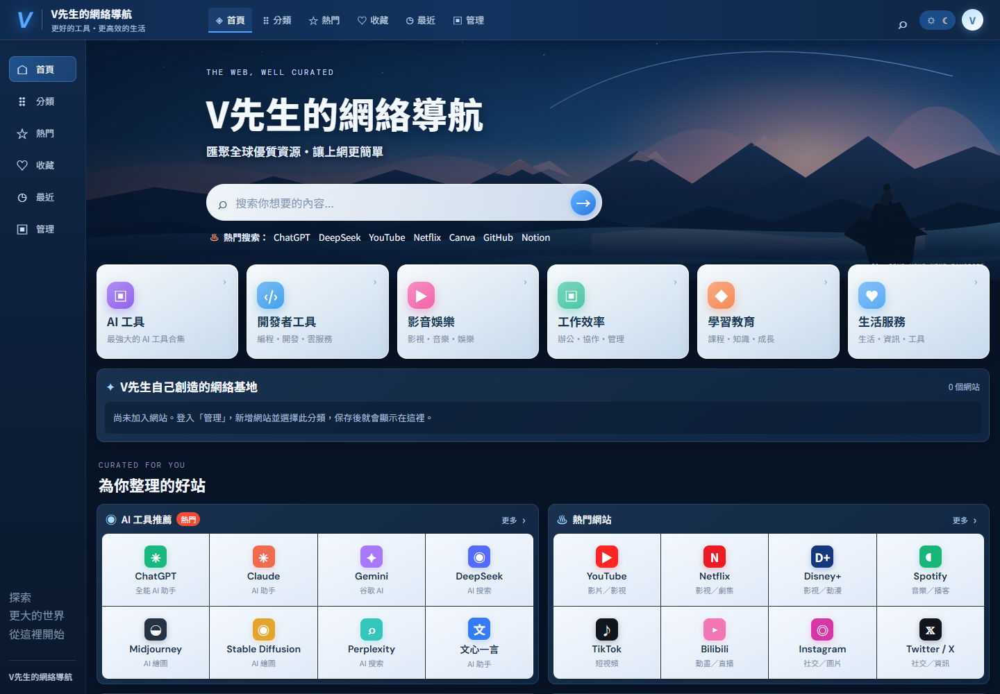

# Mr. V's Web Navigation

**Language / 語言:** [繁體中文](README.md) | English

The website follows the desktop and mobile design mockups. Administrators can sign in to manage links and save changes to Cloudflare D1.

## Homepage screenshot



## GitHub security

- Set `ADMIN_PASSWORD` and `SESSION_SECRET` only in Cloudflare Pages' secret settings. Never put their actual values in files, commits, or GitHub.
- `.env` and `.dev.vars` are not required for deployment. Local secret files and Wrangler runtime data are listed in `.gitignore`.
- `REPLACE_WITH_D1_DATABASE_ID` in `wrangler.jsonc` is a placeholder to replace when deploying with Wrangler; it is not a password or login key.

## Managing the site after signing in

Choose **Manage** on the site and enter the administrator password. When adding a link, select **V先生自己創造的網絡基地** (web bases created by Mr. V) to show it in a dedicated section above **為你整理的好站** (sites curated for you). You can also remove links in the management page. Links in other categories remain in their existing sections. Select **Save and update site** to store changes in D1; visitors will see them after refreshing. Favorites and recently visited links are stored in each visitor's browser.

The **今日推薦** (Today's recommendations) section at the bottom of the home page has been removed. When updating the layout, upload the latest `cloudflare-pages-upload.zip`. Existing D1 site data will be preserved, and older settings will automatically gain the custom web-base section.

## Deploy from the Cloudflare dashboard

Upload the prepared ZIP directly: [cloudflare-pages-upload.zip](./cloudflare-pages-upload.zip). Cloudflare Pages Direct Upload supports dragging and dropping a ZIP containing `_worker.js`. Dashboard translations may vary slightly with your language settings; the instructions below include English and Chinese names.

### 1. Create the D1 tables in Studio

If D1 Studio is already open, start with step 1. The error `no such table: main.login_attempts` means the login-rate-limit table does not exist yet. Run each SQL statement separately: press **Ctrl+A** in the editor, paste one statement, and click **Run（執行）**.

1. Create the site settings table:

   ```sql
   CREATE TABLE IF NOT EXISTS site_config (
     id INTEGER PRIMARY KEY CHECK (id = 1),
     config TEXT NOT NULL,
     updated_at TEXT NOT NULL
   );
   ```

2. Create the login rate-limit table:

   ```sql
   CREATE TABLE IF NOT EXISTS login_attempts (
     id INTEGER PRIMARY KEY AUTOINCREMENT,
     ip_hash TEXT NOT NULL,
     attempted_at TEXT NOT NULL
   );
   ```

3. Create the index:

   ```sql
   CREATE INDEX IF NOT EXISTS login_attempts_ip_time
   ON login_attempts (ip_hash, attempted_at);
   ```

   Each statement should show **Executed 1/1** with no red error. Refresh the resource list on the left and confirm that both `site_config` and `login_attempts` appear.

If you have not created a D1 database yet, choose **Storage & databases（儲存與資料庫）> D1 SQL Database（D1 SQL 資料庫）> Create database（建立資料庫）** in the Cloudflare sidebar. Name it `v-mister-navigation`, open **Studio（工作室）**, and run the SQL above.

### 2. Upload the website

4. In the sidebar, choose **Workers & Pages（Workers 與 Pages）> Create application（建立應用程式）> Get started（開始使用）> Drag and drop your files（拖放檔案）**.
5. Name the project `v-mister-navigation`, select [cloudflare-pages-upload.zip](./cloudflare-pages-upload.zip), and click **Deploy site（部署網站）**. When deployment finishes, note the `*.pages.dev` URL shown by Cloudflare.

### 3. Bind the D1 database

6. Open the Pages project and go to **Settings（設定）> Bindings（綁定）> Add（新增）> D1 database bindings（D1 資料庫綁定）**.
7. Set **Variable name（變數名稱）** to `DB`, select `v-mister-navigation` for **D1 database（D1 資料庫）**, and save.

### 4. Set the administrator password and session secret

8. In the Pages project, go to **Settings（設定）> Variables and Secrets（變數與機密）> Add（新增）** and select **Production（正式環境）**. Add a secret:
   - Name: `ADMIN_PASSWORD`. Value: choose the administrator password you want to use.
   - Select **Secret（機密）** or enable **Encrypt（加密）**.

9. Add another secret:
   - Name: `SESSION_SECRET`. Use a random string at least 32 characters long, different from the administrator password.
   - Also select **Secret（機密）** or enable **Encrypt（加密）**.

   Enter these values only in the Cloudflare dashboard. Do not put them in website files or chat messages.

### 5. Redeploy and verify

10. After saving the bindings and secrets, go to **Deployments（部署）> Create deployment（建立部署）**, select **Production（正式環境）**, and upload the same ZIP again. The bindings take effect after redeployment.
11. Open the `*.pages.dev` URL and confirm that the home page loads. On first load, the starter data from `data/sites.json` in the ZIP is written to D1.
12. Select **Manage**, sign in with `ADMIN_PASSWORD`, add a temporary test link, choose **Save and update site**, then refresh and confirm the link remains. Remove the test link, save again, and refresh to confirm it is gone. Login and saving are now verified.
13. To use your own domain, add it under **Custom domains（自訂網域）** in the Pages project and follow the DNS instructions shown.

## Future updates

Add, remove, or import links as JSON in the management page, then select **Save and update site**. No redeployment is needed for link data changes. Create a new Pages deployment and upload a new ZIP only when the website code or design changes.

## Project files

- `worker.js`: login verification, public configuration reads, and management save API.
- `migrations/0001_site_config.sql`: D1 table definition.
- `wrangler.jsonc`: configuration for deploying with Wrangler.
- `data/sites.json`: starter data and JSON backup format.
- `cloudflare-pages-upload.zip`: dashboard drag-and-drop deployment package containing `_worker.js` and the static website files.
- `DESIGN.md`: design mockup implementation specifications.
